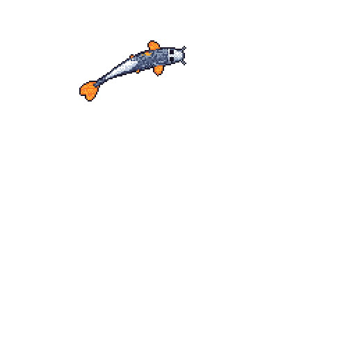

# I'm Vigneshwar T

### 🤖 AI / ML Engineer · 💻 Full-Stack Developer · 🚀 Builder

I build AI systems you can actually run, click, and use—from voice assistants and medical-report analyzers to digital twins for machines.

<p align="center">
  
</p>

<p align="center">
  
</p>

<p align="center">
  
  
  
  
  
</p>

---

## 🧠 About Me

I'm an **AI / ML engineer and full-stack developer** who likes shipping complete systems rather than isolated notebooks.

Every project below has a real **backend, a real frontend, and a real use case**:

- 🎙️ A **voice-controlled JARVIS** that answers questions from uploaded PDFs
- 🏥 A **medical records platform** that reads lab reports with OCR and Gemini
- ✈️ An **aircraft-engine digital twin** with physics, ML diagnostics, and a 3D dashboard
- 🏭 A **predictive-maintenance twin** for pneumatic cylinders
- 🏛️ A **bilingual, scroll-driven cinematic website** about Tamil heritage

I'm also honest about my results. My digital-twin repositories clearly label what is simulated, what is research-only, and what fails its own validation gates. 🔬

### ⚡ Build Loop

```text
IDEA → RESEARCH → PROTOTYPE
  ↑                    ↓
IMPROVE ← DEPLOY ← TEST & BREAK
```

### 🎯 Core Areas

- 🤖 AI assistants and automation
- 🔎 RAG, embeddings, and semantic search
- 🏭 Digital twins and predictive maintenance
- 📊 Applied machine learning with scikit-learn
- 🌐 Full-stack development with React, Next.js, FastAPI, and Node.js
- 🎮 3D web interfaces with Three.js and React Three Fiber

---

## 🚀 Featured Projects

### 🤖 J.A.R.V.I.S. — AI HR Recruiter & Cognitive Assistant

A JARVIS-themed recruitment assistant with a **3D holographic reactor core**, hands-free voice interaction, and a **PDF-powered RAG knowledge base**.

- 🎙️ Wake word `Jarvis` with continuous speech recognition and pause-based auto-submit
- 🔊 British-English text-to-speech using the Web Speech Synthesis API
- 📄 Upload resumes, policies, or job guidelines; parse and index them into a TF-IDF vector space
- 🎯 Candidate screening, resume breakdown, interview-question, and job-description generation
- 🦾 Custom GLSL shaders, orbiting tech rings, and microphone-reactive particles
- 🛡️ API keys isolated in `.env` and excluded from version control

**Stack:** `FastAPI` · `OpenRouter LLM` · `scikit-learn (TF-IDF)` · `pdfplumber` · `React` · `Three.js / R3F` · `Tailwind CSS` · `Vite`

[](https://github.com/vigneshwar0246/HCL-JARVIS)

---

### 🏥 Health Hub Connect — AI Digital Health Records

A full-stack platform where patients store, organise, and **analyse medical records with AI**.

- 📤 Upload lab results, prescriptions, and scans with OCR and PDF parsing
- 🧠 Google Gemini chatbot and smart report summarisation
- 📊 Health dashboard with vitals, appointments, and activity charts
- 💊 Medication reminders, family profiles, and PDF health-summary export
- 🔐 JWT authentication, Bcrypt hashing, Google login, and activity logging
- ⚙️ Background workers keep heavy AI jobs from blocking the UI

**Stack:** `React` · `Vite` · `TypeScript` · `Tailwind CSS` · `shadcn/ui` · `TanStack Query` · `Recharts` · `Node.js` · `Express` · `MongoDB` · `Gemini`

[](https://github.com/vigneshwar0246/health-vault)
[](https://github.com/vigneshwar0246/health_vault_chatbot)

---

### ✈️ AERION / AERO-TWIN — Aircraft Engine Digital Twin

A local **research demonstrator** combining simulated engine telemetry, validated ingestion, physics-based diagnostics, an optional ML fault classifier, and a 3D dashboard.

- 🧪 A 9-class fault model openly documented as failing its `0.80` per-fault recall gate
- 🧪 A 10-class scenario classifier achieving approximately `95%` on synthetic data
- 🔁 Recorded mission replay, bounded diagnostic history, and SQLite schema v4
- ✅ CI workflow, independent audit, and `118 backend + 7 browser acceptance tests` passing at last record
- 🧾 Every score is labelled as uncalibrated and simulated—not flight-certified

**Stack:** `Python 3.13` · `FastAPI` · `scikit-learn` · `SQLite` · `React` · `Three.js` · `GitHub Actions`

[](https://github.com/vigneshwar0246/Digital-twin-for-UAV-Drone)

---

### 🏭 AI Digital Twin — Pneumatic Cylinder Health Monitoring

Predictive maintenance for industrial automation: a live twin of a pneumatic cylinder driven by simulated sensors and machine learning.

- 📡 Simulation of pressure, temperature, position, speed, flow, vibration, load, and cycle count
- 🧠 Twenty-three engineered features for classifying `Healthy`, `Air Leakage`, `Pressure Drop`, `Seal Wear`, and `Valve Sticking`
- ❤️ Experimental health-score regressor and Remaining Useful Life estimation when a declining trend exists
- 🔌 REST and WebSocket APIs, MQTT support, and SQLite prediction history
- 🐳 Docker, Docker Compose, and Nginx deployment
- 🛡️ Advisory output only; it never operates hardware

**Stack:** `Python` · `FastAPI` · `NumPy` · `Pandas` · `scikit-learn` · `React` · `Vite` · `MQTT` · `Docker`

[](https://github.com/vigneshwar0246/AI-Digital-Twin-for-Pneumatic-Cylinder-Health-Monitoring)

---

### 🏛️ Tamil Heritage — Cinematic Bilingual Website

An image-rich, **bilingual exploration of Tamil culture** with a scroll-driven cinematic introduction.

- 🎬 Scroll-driven video intro with global language and entry-state context
- 🗂️ Category-organised heritage imagery and cultural entries
- 🧪 Chrome end-to-end tests with desktop and mobile screenshots
- 🚀 Auto-deployed from `main` to Vercel

**Stack:** `Next.js` · `TypeScript` · `Tailwind CSS` · `E2E browser tests` · `Vercel`

[](https://tamil-mandram-tau.vercel.app)
[](https://github.com/vigneshwar0246/tamil-mandram-)

---

### 🦠 Graph-Based Virus Spread Simulation

A **C project** that simulates infection spread across a network using graphs and BFS, demonstrating my data-structures and algorithms foundation.

[](https://github.com/vigneshwar0246/Graph-Based-Virus-Spread-Simulation)

---

## 🛠️ Tech Stack

<p align="center"><strong>Languages</strong><br /></p>
<p align="center"><strong>AI / ML / Data</strong><br /></p>
<p align="center"><strong>Frontend</strong><br /></p>
<p align="center"><strong>Backend and Data</strong><br /></p>
<p align="center"><strong>DevOps and Tools</strong><br /></p>

---

## 🔥 What I'm Working On

| Focus | Status |
|---|---|
| ✈️ **AERION** engine twin: calibration, replay, and validation gates | 🟢 Actively developing |
| 🤖 **JARVIS**: richer recruiter workflows on top of the RAG engine | 🟡 Iterating |
| 🏥 **Health Hub Connect**: deeper report analysis and trends | 🟡 Iterating |
| 🏭 **Pneumatic twin**: real IoT sensors, ESP32, LSTM, Grafana, and edge AI | 🔵 Roadmap |

---

## 📊 GitHub Stats

<p align="center"></p>
<p align="center"></p>
<p align="center"></p>

---

## 🐟 My GitHub Koi

<p align="center"></p>

---

## 📅 My Contributions

<p align="center"></p>
<p align="center"></p>

---

## 📈 Profile Summary

<p align="center"></p>
<p align="center"></p>
<p align="center"></p>

---

## 🌐 Let's Connect

<p align="center">
  <a href="https://github.com/vigneshwar0246"></a>
  <a href="https://tamil-mandram-tau.vercel.app"></a>
</p>

<p align="center"></p>

<p align="center"><strong>BUILD → BREAK → LEARN → IMPROVE</strong></p>
<p align="center">⭐ Thanks for visiting. If something here is useful, drop a star.</p>

<!-- Verification notes:
- The Tamil Heritage URL may redirect from tamil-mandram-tau.vercel.app to tamil-heritage.vercel.app.
- Ensure koi/koi.gif exists in the profile repository.
- External badge, stats, contribution, typing-animation, and icon services may rate-limit or become unavailable.
- Manually maintained counts and test totals should be updated periodically.
- count_private=true may not show private data without service authorization.
- LinkedIn was intentionally omitted because no real profile URL was provided.
-->
