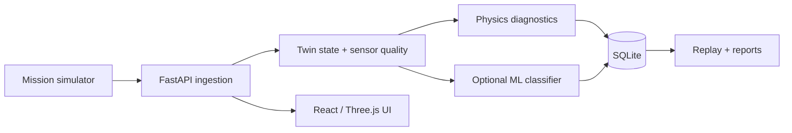
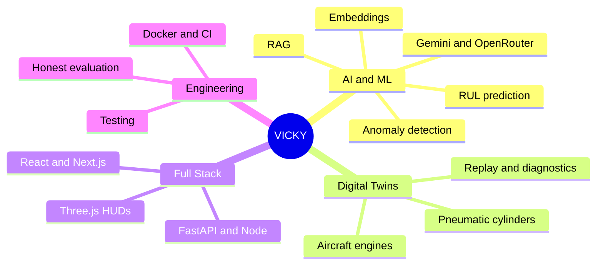

<!--
  THEME: "ARC REACTOR HUD"
  Background  #0D1117   |  Primary  #FF5A1F (reactor orange)
  Accent      #00E5FF   |  Text     #C9D1D9
  Keep these 4 colors everywhere so the whole profile feels like one system.
-->

<div align="center">


<br>


<br><br>

<!-- ===== STICKER WALL ===== -->


<br>


</div>

<br>

---

## 🧬 `whoami`

```ts
const vicky = {
  role:      "AI / ML Engineer & Full Stack Developer",
  obsession: ["digital twins", "RAG", "voice interfaces", "3D dashboards"],
  builds:    "AI that ships: backend + frontend + a real use case",
  philosophy: "Build → Break → Learn → Improve",
  honesty:   "I label simulated data as simulated and failed gates as failed",
  currently: "AERION: an aircraft-engine digital twin ✈️",
  funFact:   "My JARVIS says 'At your service, sir.' and means it",
};
```

---

## 🎛️ MISSION CONTROL — Featured Projects

<div align="center">

<a href="https://github.com/vigneshwar0246/HCL-JARVIS">

</a>
<a href="https://github.com/vigneshwar0246/health-vault">

</a>

<a href="https://github.com/vigneshwar0246/Digital-twin-for-UAV-Drone">

</a>
<a href="https://github.com/vigneshwar0246/AI-Digital-Twin-for-Pneumatic-Cylinder-Health-Monitoring">

</a>

<a href="https://github.com/vigneshwar0246/tamil-mandram-">

</a>
<a href="https://github.com/vigneshwar0246/Graph-Based-Virus-Spread-Simulation">

</a>

</div>

<br>

<details>
<summary><b>🤖 &nbsp;J.A.R.V.I.S. — AI HR Recruiter & Cognitive Assistant</b> &nbsp;<sub>(click to expand)</sub></summary>

<br>

> A JARVIS-themed recruitment assistant with a **3D holographic reactor core**, hands-free voice control and a **PDF-powered RAG knowledge base**.

| Module | What it does |
|:--|:--|
| 🎙️ **Voice** | Say "Jarvis" → *"At your service, sir."* Continuous recognition, auto-submit on pause |
| 🔊 **TTS** | British-English synthesis through the Web Speech API |
| 📄 **RAG** | `pdfplumber` → semantic chunks → **live TF-IDF index** of resumes, policies, job guidelines |
| 🎯 **Recruiter tools** | Candidate screening, resume breakdown, interview questions, JD generation |
| 🦾 **3D HUD** | Three.js / R3F reactor core, custom GLSL shaders, particles reacting to mic level |
| 🛡️ **Security** | Keys isolated in `.env`, excluded from git |

`FastAPI` `OpenRouter` `scikit-learn` `pdfplumber` `React` `Three.js` `Tailwind v4` `Vite`

</details>

<details>
<summary><b>🏥 &nbsp;HEALTH HUB CONNECT — AI Digital Health Records</b></summary>

<br>

> Patients upload, organise and **analyse their medical records with AI**.

- 📤 **OCR (Tesseract.js) + PDF parsing** for lab results, prescriptions and scans
- 🧠 **Google Gemini** chatbot and smart report summarisation
- 📊 Vitals dashboard · 💊 medication reminders · 👨‍👩‍👧 family profiles · 📄 PDF export
- 🔐 JWT, Bcrypt, Google login, activity logging
- ⚙️ Background worker keeps heavy AI jobs off the UI thread

`React` `Vite` `TypeScript` `shadcn/ui` `TanStack Query` `Recharts` `Node` `Express` `MongoDB` `Gemini`

</details>

<details>
<summary><b>✈️ &nbsp;AERION / AERO-TWIN — Aircraft Engine Digital Twin</b> &nbsp;🔥 <sub>latest</sub></summary>

<br>

> A local **research demonstrator**: simulated telemetry → validated ingestion → physics diagnostics → optional ML → 3D dashboard.



- 🧪 Two research classifiers, including a 9-class fault model that **openly fails its own 0.80 recall gate**
- 🔁 Recorded mission replay · bounded diagnostic history · SQLite schema v4
- ✅ CI, independent audit, **118 backend + 7 browser acceptance tests** at last record
- 🧾 Every score labelled *simulated / uncalibrated, not flight-certified*

`Python 3.13` `FastAPI` `scikit-learn` `SQLite` `React` `Three.js` `GitHub Actions`

</details>

<details>
<summary><b>🏭 &nbsp;PNEUMATIC CYLINDER DIGITAL TWIN — Predictive Maintenance</b></summary>

<br>

- 📡 Live sensors: pressure, temperature, position, speed, flow, vibration, load, cycles
- 🧠 **23 engineered features** → classifier for `Healthy · Air Leakage · Pressure Drop · Seal Wear · Valve Sticking`
- ❤️ Experimental health regressor + **RUL** (only when a real decline trend exists)
- 🔌 REST + **WebSocket** APIs · MQTT · SQLite history
- 🐳 Docker · Compose · Nginx · advisory-only, never drives hardware

`Python` `FastAPI` `NumPy` `Pandas` `scikit-learn` `React` `MQTT` `Docker`

</details>

<details>
<summary><b>🏛️ &nbsp;TAMIL HERITAGE — Cinematic Bilingual Website</b> &nbsp;🌐 <sub>live</sub></summary>

<br>

> Image-rich, **bilingual** exploration of Tamil culture with a scroll-driven cinematic intro, auto-deployed to Vercel.

[**▶ Open the live site**](https://tamil-mandram-tau.vercel.app)

`Next.js` `TypeScript` `Tailwind` `E2E tests` `Vercel`

</details>

---

## 🧩 SKILL TREE

<div align="center">

<br><br>
<br><br>
<br><br>


</div>



---

## 🏆 TROPHY CASE

<div align="center">


</div>

---

## 📡 TELEMETRY — Live GitHub Stats

<div align="center">


<br>


</div>

---

## 📅 CONTRIBUTION SIGNAL

<div align="center">


</div>

---

## 🔭 ROADMAP

| | Mission | Status |
|:-:|:--|:-:|
| ✈️ | **AERION**: calibration, replay, validation gates |  |
| 🤖 | **JARVIS**: richer recruiter workflows on the RAG core |  |
| 🏥 | **Health Hub**: deeper report analysis and trends |  |
| 🏭 | **Pneumatic twin**: real ESP32 sensors, LSTM, Grafana, edge AI |  |

---

<div align="center">

### 📬 COMMS CHANNEL

<a href="https://github.com/vigneshwar0246"></a>
<a href="https://www.linkedin.com/in/YOUR-LINKEDIN-USERNAME"></a>
<a href="https://tamil-mandram-tau.vercel.app"></a>

<br><br>


<br>

<sub>`BUILD → BREAK → LEARN → IMPROVE`</sub>


</div>
