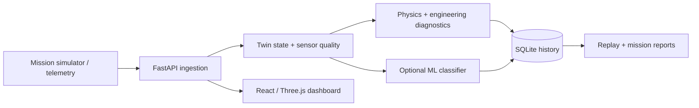

# I'M VIGNESHWAR T

### 🤖 AI / ML ENGINEER • 💻 FULL STACK DEVELOPER • 🚀 BUILDER

**I build AI systems you can actually run, click and use: voice assistants, medical-report analyzers, and digital twins for machines.**

<br>

<div align="center">
<br><br>


<br><br>


<br><br>


</div>

---

# 🧠 ABOUT ME

<table>
<tr>
<td width="55%" valign="top">

I'm an **AI / ML engineer and full-stack developer** who likes shipping complete systems rather than isolated notebooks.

Every project below has a real **backend, a real frontend, and a real use case**:

- 🎙️ A **voice-controlled JARVIS** that answers questions from PDFs you upload
- 🏥 A **medical records platform** that reads lab reports with OCR + Gemini
- ✈️ An **aircraft-engine digital twin** with physics, ML diagnostics and a 3D dashboard
- 🏭 A **predictive-maintenance twin** for pneumatic cylinders
- 🏛️ A **bilingual, scroll-driven cinematic website** on Tamil heritage

I'm also honest about my results. My digital-twin repos clearly label what is simulated, what is research-only, and what fails its own validation gates. 🔬

</td>
<td width="45%" valign="top">

### ⚡ Build Loop

```text
IDEA → RESEARCH → PROTOTYPE
  ↑                    ↓
IMPROVE ← DEPLOY ← TEST & BREAK
```

### 🎯 Core Areas

- 🤖 AI Assistants & Automation
- 🔎 RAG, Embeddings & Semantic Search
- 🏭 Digital Twins & Predictive Maintenance
- 📊 Applied Machine Learning (scikit-learn)
- 🌐 Full Stack (React, Next.js, FastAPI, Node)
- 🎮 3D Web UI (Three.js / React Three Fiber)

</td>
</tr>
</table>

---

# 🚀 FEATURED PROJECTS

## 🤖 J.A.R.V.I.S. — AI HR Recruiter & Cognitive Assistant

> A JARVIS-themed recruitment assistant with a **3D holographic reactor core**, hands-free voice interaction and a **PDF-powered RAG knowledge base**.

| | |
|---|---|
| 🎙️ **Voice** | Wake word "Jarvis" → *"At your service, sir."* Continuous speech recognition with auto-submit on pause |
| 🔊 **Speech output** | British-English text-to-speech via the Web Speech Synthesis API |
| 📄 **RAG** | Upload resumes, policies or job guidelines. `pdfplumber` parses them, chunks them and indexes them into a **TF-IDF vector space in real time** |
| 🎯 **Recruiter tools** | One-click candidate screening, resume breakdown, interview-question and job-description generation |
| 🦾 **3D HUD** | Custom GLSL shaders, orbiting tech rings and particles that react to mic audio level |
| 🛡️ **Security** | API keys isolated in `.env`, excluded from version control |

**Stack:** `FastAPI` · `OpenRouter LLM` · `scikit-learn (TF-IDF)` · `pdfplumber` · `React` · `Three.js / R3F` · `TailwindCSS v4` · `Vite`

<a href="https://github.com/vigneshwar0246/HCL-JARVIS"></a>

---

## 🏥 HEALTH HUB CONNECT — AI Digital Health Records

> A full-stack platform where patients store, organise and **analyse medical records with AI**.

- 📤 Upload lab results, prescriptions and scans, with **OCR (Tesseract.js) + PDF parsing**
- 🧠 **Google Gemini** chatbot and **smart report summarisation**
- 📊 Health dashboard with vitals, appointments and activity charts
- 💊 Medication reminders · 👨‍👩‍👧 family profiles · 📄 PDF health-summary export
- 🔐 JWT auth, Bcrypt hashing, Google login, activity logging
- ⚙️ Background worker so heavy AI jobs never block the UI

**Stack:** `React` · `Vite` · `TypeScript` · `Tailwind` · `shadcn/ui` · `TanStack Query` · `Recharts` · `Node.js` · `Express` · `MongoDB` · `Gemini`

<a href="https://github.com/vigneshwar0246/health-vault"></a>
<a href="https://github.com/vigneshwar0246/health_vault_chatbot"></a>

---

## ✈️ AERION / AERO-TWIN — Aircraft Engine Digital Twin 🔥 *latest*

> A local **research demonstrator** combining simulated engine telemetry, validated ingestion, physics-based diagnostics, an optional ML fault classifier and a 3D dashboard.



- 🧪 **Two separate research classifiers**: a 9-class fault model, which is *openly documented as failing* its 0.80 per-fault recall gate, and a 10-class scenario classifier (≈95% on synthetic data)
- 🔁 Recorded **mission replay**, bounded diagnostic history, SQLite schema v4
- ✅ CI workflow, independent audit, **118 backend + 7 browser acceptance tests** passing at last record
- 🧾 Strong engineering honesty: every score is labelled *uncalibrated / simulated, not flight-certified*

**Stack:** `Python 3.13` · `FastAPI` · `scikit-learn` · `SQLite` · `React` · `Three.js` · `GitHub Actions`

<a href="https://github.com/vigneshwar0246/Digital-twin-for-UAV-Drone"></a>

---

## 🏭 AI DIGITAL TWIN — Pneumatic Cylinder Health Monitoring

> Predictive maintenance for industrial automation: a live twin of a pneumatic cylinder driven by simulated sensors and ML.

- 📡 Live simulation of **pressure, temperature, position, speed, flow, vibration, load, cycle count**
- 🧠 **23 engineered features** → fault classifier for `Healthy · Air Leakage · Pressure Drop · Seal Wear · Valve Sticking`
- ❤️ Experimental **health-score regressor** + **Remaining Useful Life** (only when a real declining trend exists)
- 🔌 REST **and WebSocket** APIs, MQTT support, SQLite prediction history
- 🐳 Docker · Docker Compose · Nginx deployment
- 🛡️ Advisory output only; it never operates hardware

**Stack:** `Python` · `FastAPI` · `NumPy` · `Pandas` · `scikit-learn` · `React` · `Vite` · `MQTT` · `Docker`

<a href="https://github.com/vigneshwar0246/AI-Digital-Twin-for-Pneumatic-Cylinder-Health-Monitoring"></a>

---

## 🏛️ TAMIL HERITAGE — Cinematic Bilingual Website 🌐 *live*

> An image-rich, **bilingual exploration of Tamil culture** with a scroll-driven cinematic introduction.

- 🎬 Scroll-driven video intro, with a global language and entry-state context
- 🗂️ Category-organised heritage imagery and culture entries
- 🧪 Chrome end-to-end tests with desktop + mobile screenshots
- 🚀 Auto-deployed from `main` to Vercel

**Stack:** `Next.js` · `TypeScript` · `Tailwind` · `E2E browser tests` · `Vercel`

<a href="https://tamil-mandram-tau.vercel.app"></a>
<a href="https://github.com/vigneshwar0246/tamil-mandram-"></a>

---

## 🦠 Graph-Based Virus Spread Simulation

> A **C** project that simulates infection spread across a network using **graphs and BFS**. It shows my data-structures and algorithms foundation.

<a href="https://github.com/vigneshwar0246/Graph-Based-Virus-Spread-Simulation"></a>

---

# 🛠️ TECH STACK *(from my actual repos)*

<div align="center">

**💻 Languages**


**🧠 AI / ML / Data**


**🌐 Frontend**


**⚙️ Backend & Data**


**🚢 DevOps & Tools**


</div>

---

# 🔥 WHAT I'M WORKING ON NOW

| 🎯 Focus | 📌 Status |
|---|---|
| ✈️ **AERION** engine twin: calibration, replay and validation gates | 🟢 Actively developing (most recent commits) |
| 🤖 **JARVIS**: richer recruiter workflows on top of the RAG engine | 🟡 Iterating |
| 🏥 **Health Hub Connect**: deeper report analysis and trends | 🟡 Iterating |
| 🏭 **Pneumatic twin**: real IoT sensors / ESP32, LSTM, Grafana, edge AI | 🔵 Roadmap |

---

# 📊 GITHUB STATS

<div align="center">


<br><br>


</div>

---

# 📅 MY REAL CONTRIBUTIONS

<div align="center">


<br><br>


</div>

---

# 📈 PROFILE SUMMARY

<div align="center">


<br><br>


</div>

---

# 🌐 LET'S CONNECT

<div align="center">

<a href="https://github.com/vigneshwar0246"></a>
<a href="https://www.linkedin.com/in/YOUR-LINKEDIN-USERNAME"></a>
<a href="https://tamil-mandram-tau.vercel.app"></a>

<br><br>


<br><br>

### `BUILD → BREAK → LEARN → IMPROVE`

**⭐ Thanks for visiting. If something here is useful, drop a star.**

</div>
